<div align="center">

<picture>
  <source media="(prefers-color-scheme: dark)" srcset="media/pcb/transmitter-layout-top.png">
  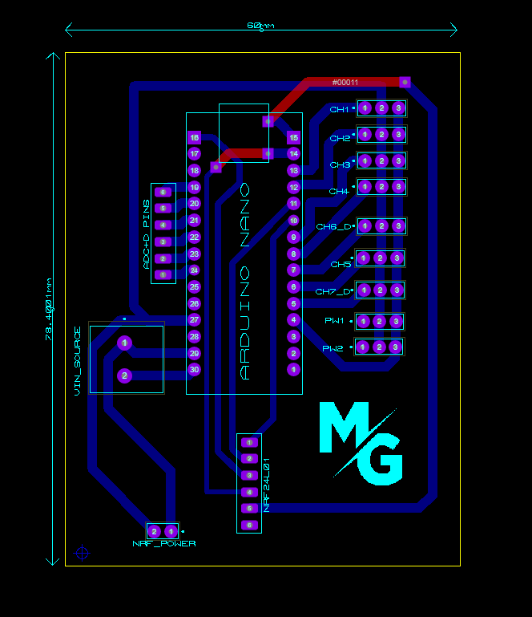
</picture>

# 9-Channel Wireless Transmitter & Receiver

### Custom PCB Hardware · Embedded Firmware · nRF24L01+ · ArduPilot-Compatible PWM

[](#)
[](#)
[](#)
[](#)
[](#)

**Designed, programmed, assembled, and tested by Mohamed Gamal**

[GitHub](https://github.com/MohamedGamal045) · [LinkedIn](https://www.linkedin.com/in/mohamedgamal045/) · [Portfolio](https://sites.google.com/view/mgengineer) · [YouTube](https://www.youtube.com/@mgengineer981)

</div>

---

> [!IMPORTANT]
> **Hardware status:** the physical PCB design includes space for **nine control positions**.
>
> **Firmware status:** the original final firmware implements **seven channels**. Channels 8 and 9 are controlled by physical switches on **A4/A5**, but they are not currently read or transmitted by the source code.

---

## Project at a Glance

<table>
  <tr>
    <td align="center" width="33%">
      
      <b>Custom Transmitter PCB</b>
    </td>
    <td align="center" width="33%">
      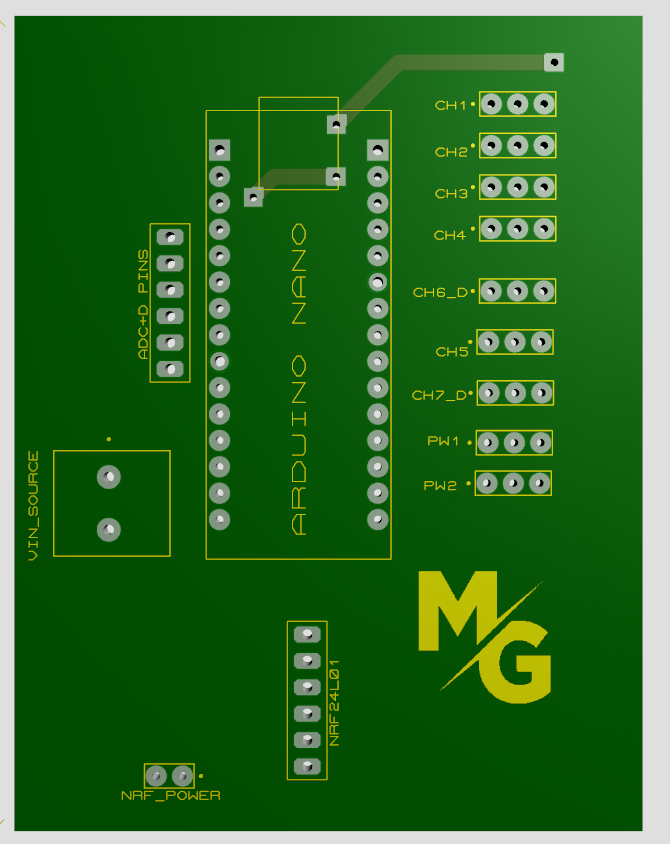
      <b>Custom Receiver PCB</b>
    </td>
    <td align="center" width="33%">
      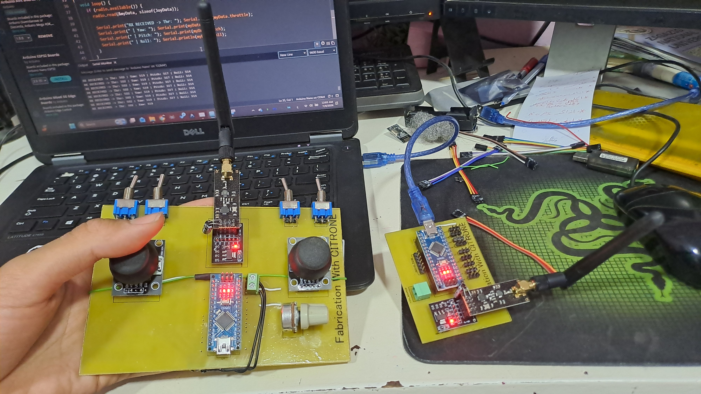
      <b>Bench Assembly</b>
    </td>
  </tr>
</table>

---

## Live Demonstrations

<table>
  <tr>
    <td width="33%">
      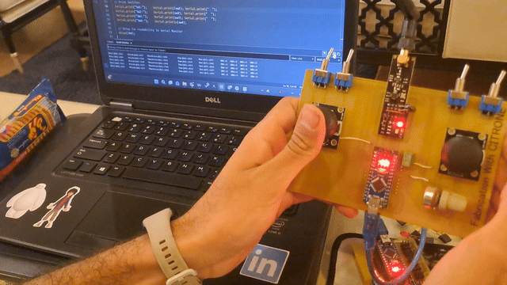
      <p align="center"><b>Transmitter Operation</b></p>
    </td>
    <td width="33%">
      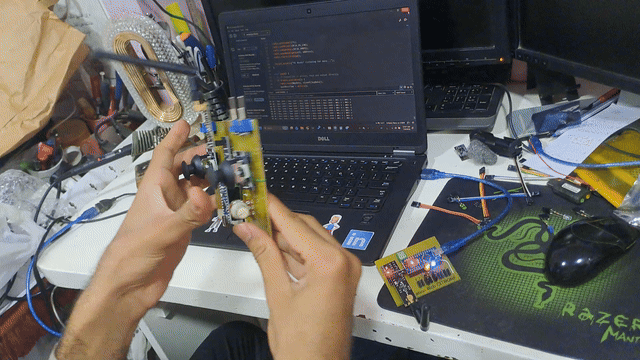
      <p align="center"><b>Receiver Operation</b></p>
    </td>
    <td width="33%">
      
      <p align="center"><b>Wireless Bench Demo</b></p>
    </td>
  </tr>
</table>

---

## System Architecture


> The diagram shows the verified firmware data path. The additional A4/A5 switches are **hardware positions**, not yet integrated into the final packet.

---

## Channel Overview

### Programmed in the Current Firmware

| CH | Transmitter | Receiver Pin | PWM | Function |
|---:|---|---:|---|---|
| 1 | A2 | D10 | 1000–2000 µs | Roll |
| 2 | A3 | D9 | 1000–2000 µs | Pitch |
| 3 | A1 | D6 | 1000–2000 µs | Throttle |
| 4 | A0 | D5 | 1000–2000 µs | Yaw |
| 5 | A7 | D3 | 1000–2000 µs | Potentiometer |
| 6 | D9 | D4 | 1000 / 2000 µs | Switch 1 |
| 7 | D10 | D2 | 1000 / 2000 µs | Switch 2 |

### Physical Hardware Positions

| CH | Hardware Switch | Proposed TX Input | Current Firmware |
|---:|---|---|---|
| 8 | Switch 3 | A4 | Not implemented |
| 9 | Switch 4 | A5 | Not implemented |

The receiver PCB includes corresponding output and power socket areas. Nano pin assignment, PWM/supply function, voltage, polarity, and regulator requirements must be verified from the actual wiring before use.

---

## PCB Engineering

<table>
  <tr>
    <td align="center" width="50%">
      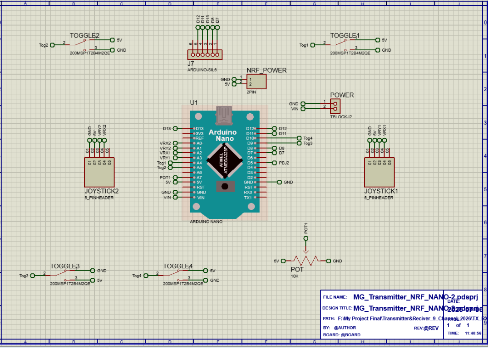
      <b>Transmitter Schematic</b>
    </td>
    <td align="center" width="50%">
      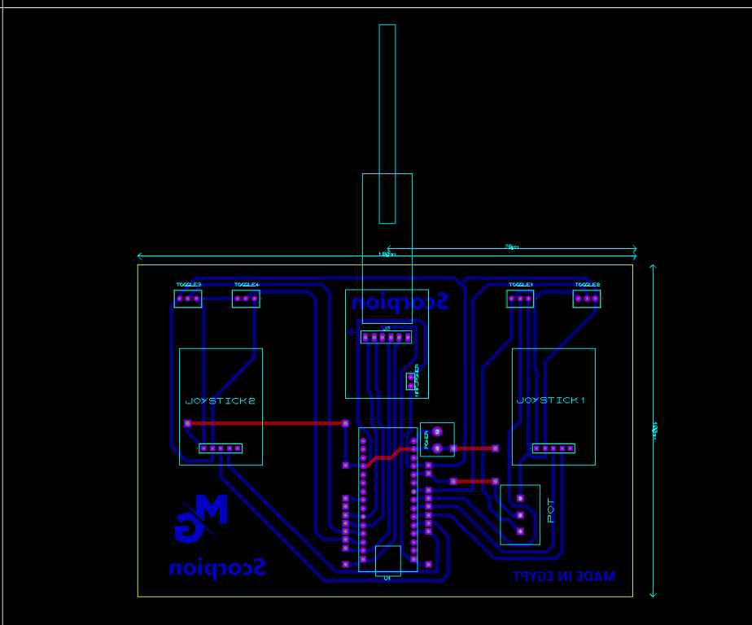
      <b>Transmitter PCB Layout</b>
    </td>
  </tr>
  <tr>
    <td align="center" width="50%">
      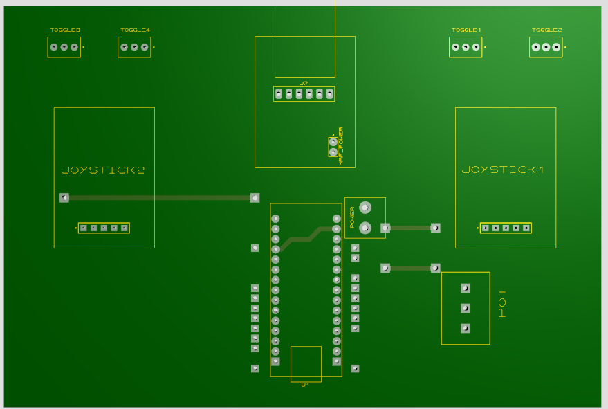
      <b>Transmitter Fabrication Layer</b>
    </td>
    <td align="center" width="50%">
      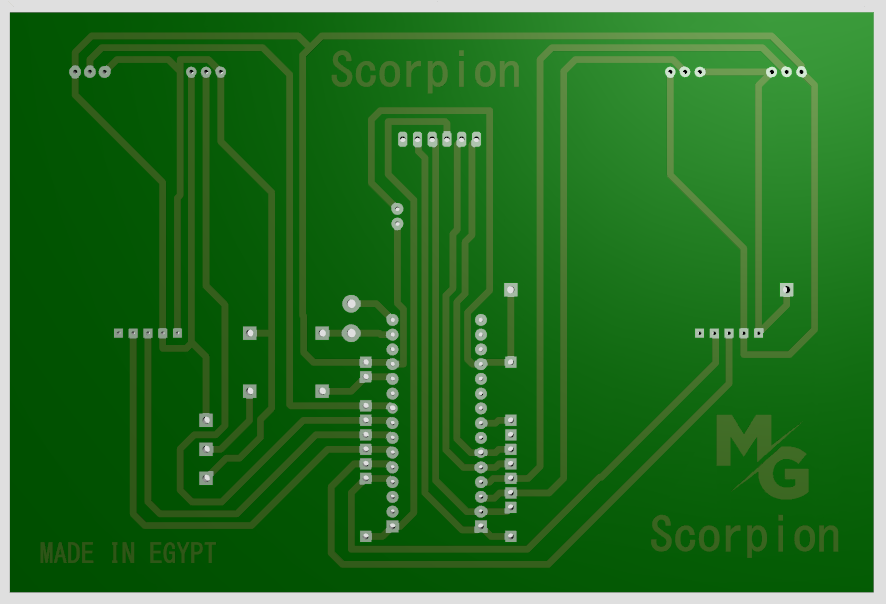
      <b>Receiver Fabrication Layer</b>
    </td>
  </tr>
</table>

### Hardware Resources

- [Proteus transmitter project](hardware/proteus/transmitter/MG_Transmitter_NRF_NANO-2.pdsprj)
- [Proteus receiver project](hardware/proteus/receiver/MG_Receiver_NRF_NANO-2.pdsprj)
- [Transmitter PCB PDFs](hardware/pcb-fabrication/transmitter/)
- [Receiver PCB PDFs](hardware/pcb-fabrication/receiver/)
- [Bundled nRF24L01 library](libraries/nRF24L01-master.zip)

---

## Firmware

<table>
  <tr>
    <th>Firmware</th>
    <th>Purpose</th>
  </tr>
  <tr>
    <td><a href="firmware/transmitter/TX.ino"><b>TX.ino</b></a></td>
    <td>Seven-channel final transmitter payload</td>
  </tr>
  <tr>
    <td><a href="firmware/receiver/RX.ino"><b>RX.ino</b></a></td>
    <td>Seven-channel PWM receiver and one-second failsafe</td>
  </tr>
  <tr>
    <td><a href="firmware/testing/TX_NRF_Test.ino"><b>TX_NRF_Test.ino</b></a></td>
    <td>Four-channel raw RF test</td>
  </tr>
  <tr>
    <td><a href="firmware/testing/RX_NRF_Test.ino"><b>RX_NRF_Test.ino</b></a></td>
    <td>Four-channel serial receive test</td>
  </tr>
</table>

---

## Communication Setup

| Parameter | Verified Value |
|---|---|
| Wireless device | nRF24L01+ |
| RF channel | 76 |
| Data rate | 1 Mbps |
| TX power | Low |
| Address | `NODE1` |
| CE / CSN | D7 / D8 |
| Packet interval | 50 ms |
| Output convention | 1000–2000 µs PWM |

---

## Receiver Failsafe

```text
NO PACKET FOR 1 SECOND
          |
          v
Throttle  = 1000 us
Roll      = 1500 us
Pitch     = 1500 us
Yaw       = 1500 us
Pot       = 1500 us
Switches  = 1000 us
```

This behavior is implemented in the receiver firmware. Add independent mechanical, electrical, or system-level protection for all external equipment.

---

## Build Gallery

<table>
  <tr>
    <td align="center">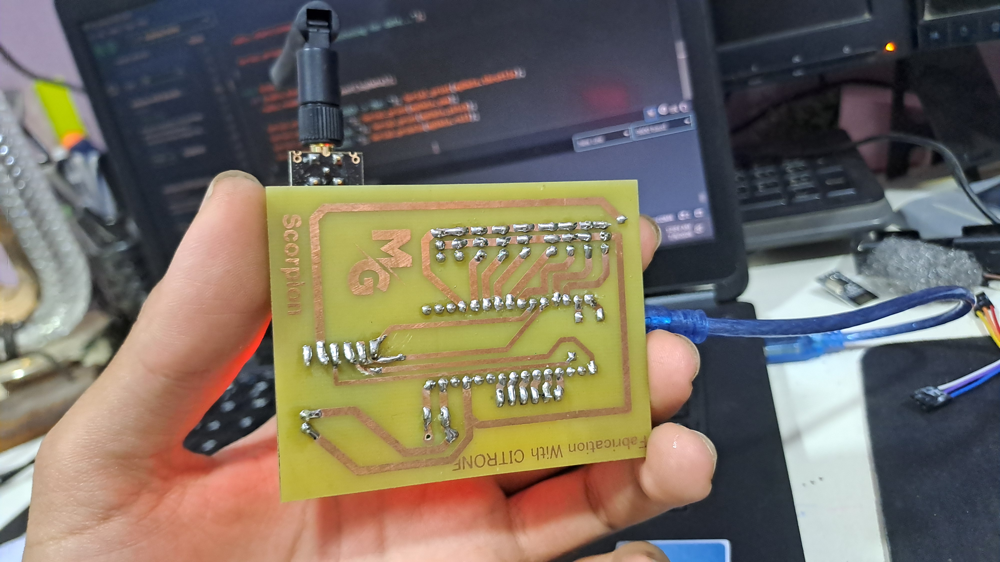<br><b>Hand-etched PCB prototype</b></td>
    <td align="center">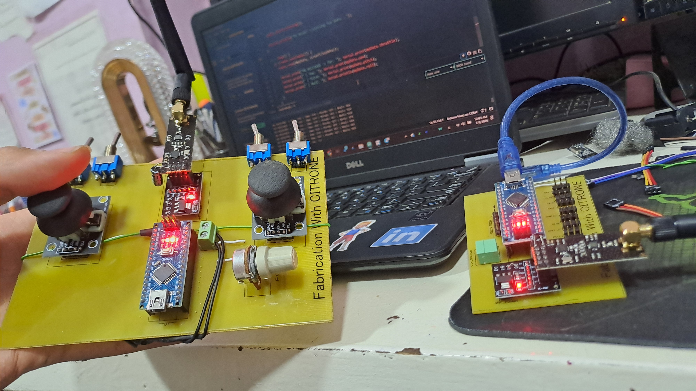<br><b>Hardware assembly and programming</b></td>
  </tr>
  <tr>
    <td align="center">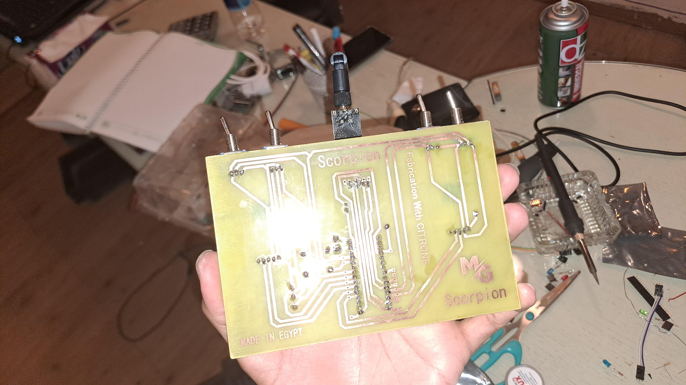<br><b>PCB fabrication work</b></td>
    <td align="center">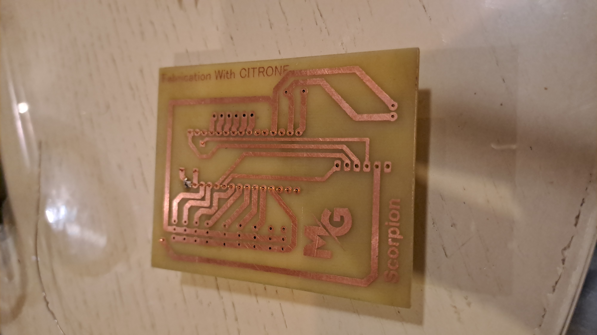<br><b>Fabricated PCB preview</b></td>
  </tr>
</table>

---

## Documentation

- [System Architecture](docs/system-architecture.md)
- [Transmitter Documentation](docs/transmitter-documentation.md)
- [Receiver Documentation](docs/receiver-documentation.md)
- [Communication Overview](docs/communication-overview.md)
- [ArduPilot Integration](docs/ardupilot-integration.md)
- [Testing and Validation](docs/testing-and-validation.md)

---

## Safe Bench Usage

1. Disconnect motors or powered actuators.
2. Verify PWM with an oscilloscope or servo tester.
3. Confirm all channel directions and endpoints.
4. Check switch polarity and failsafe output.
5. Verify power, voltage, and connector polarity before external connections.
6. Reconnect powered equipment only after bench testing is complete.

---

<div align="center">

### Mohamed Gamal

**Mechatronics Engineering Technology · Embedded Systems · Electronics · PCB Design · Robotics · IoT**

[GitHub](https://github.com/MohamedGamal045) · [LinkedIn](https://www.linkedin.com/in/mohamedgamal045/) · [Portfolio](https://sites.google.com/view/mgengineer) · [YouTube](https://www.youtube.com/@mgengineer981)

**Designed. Developed. Tested. Engineered by Mohamed Gamal.**

</div>
