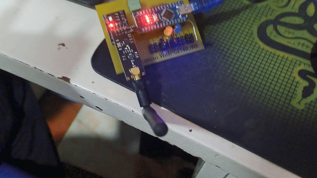
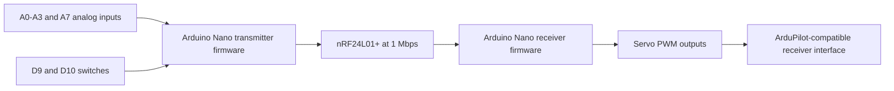

# 9-Channel Wireless Transmitter & Receiver

**Custom PCB Design | Embedded Firmware | nRF24L01 Wireless Communication | ArduPilot-Compatible PWM**

**Designed. Developed. Tested. Engineered by Mohamed Gamal.**

[GitHub](https://github.com/MohamedGamal045) · [LinkedIn](https://www.linkedin.com/in/mohamedgamal045/) · [Engineering Portfolio](https://sites.google.com/view/mgengineer) · [YouTube](https://www.youtube.com/@mgengineer981)

---

> **Implementation status:** The original firmware in this repository provides **7 channels**, not 9. “9-channel” remains the project name supplied with the original hardware archive; no verified source or demonstration supports two additional channels.

## Project Overview

This project combines custom transmitter and receiver PCB work, Arduino firmware, nRF24L01 wireless communication, PWM output generation, and receiver failsafe behavior. The system reads joystick and switch inputs, transmits a packed data structure, and reproduces control values as microsecond-based PWM signals.

The receiver output stage is compatible with control receivers or autopilot RC-input interfaces that accept the 1000–2000 µs PWM convention. The source code demonstrates the receiver mapping for this project. No flight behavior, vehicle configuration, or ArduPilot parameter setup beyond the source code is claimed.

## Hardware Demonstration

### Recorded Operation

**Transmitter and bench setup demonstration**

**Receiver and software test demonstration**

**Wireless hardware demonstration**

## System Architecture

## Verified Channel Mapping

| Channel | Transmitter input | Receiver PWM pin | Range |
|---:|---|---:|---:|
| 1 — Roll | A2 | D10 | 1000–2000 µs |
| 2 — Pitch | A3 | D9 | 1000–2000 µs |
| 3 — Throttle | A1 | D6 | 1000–2000 µs |
| 4 — Yaw | A0 | D5 | 1000–2000 µs |
| 5 — Potentiometer | A7 | D3 | 1000–2000 µs |
| 6 — Switch 1 | D9, pull-up | D4 | 1000 or 2000 µs |
| 7 — Switch 2 | D10, pull-up | D2 | 1000 or 2000 µs |

The test firmware uses four channels only: throttle, yaw, pitch, and roll. It does not transmit the potentiometer or switches.

## Communication Configuration

- RF address: `NODE1`
- RF channel: 76
- Data rate: 1 Mbps
- TX power: Low
- nRF24L01 CE/CSN pins: D7/D8
- Transmission interval: approximately 50 ms
- Transport: RF24 `write()` with a packed `JoyData` structure
- Analog conversion: 0–1023 mapped to 1000–2000 µs

## Receiver Failsafe

If no valid packet is received for more than one second, the firmware sets:

- Throttle: 1000 µs
- Roll, pitch, yaw, and potentiometer: 1500 µs
- Switch 1 and switch 2: 1000 µs

## Firmware

| Firmware | Purpose |
|---|---|
| [TX.ino](firmware/transmitter/TX.ino) | Final transmitter implementation for seven channels |
| [RX.ino](firmware/receiver/RX.ino) | Final receiver implementation with PWM outputs and failsafe |
| [TX_NRF_Test.ino](firmware/testing/TX_NRF_Test.ino) | Basic nRF24L01 test transmitter for four analog channels |
| [RX_NRF_Test.ino](firmware/testing/RX_NRF_Test.ino) | Basic nRF24L01 test receiver for four analog channels |

The original files are copied without source modification. Library inclusion can require installing RF24 and nRF24L01 support in the Arduino IDE.

## Hardware and PCB Design

- [Proteus transmitter project](hardware/proteus/transmitter/MG_Transmitter_NRF_NANO-2.pdsprj)
- [Proteus receiver project](hardware/proteus/receiver/MG_Receiver_NRF_NANO-2.pdsprj)
- [Transmitter PCB PDFs](hardware/pcb-fabrication/transmitter/)
- [Receiver PCB PDFs](hardware/pcb-fabrication/receiver/)
- [Bundled nRF24 library archive](libraries/nRF24L01-master.zip)

Additional library dependency names are imported directly in the Arduino source. The bundled nRF24 archive includes its own MIT license.

## Project Documentation

- [System Architecture](docs/system-architecture.md)
- [Transmitter Documentation](docs/transmitter-documentation.md)
- [Receiver Documentation](docs/receiver-documentation.md)
- [Communication Overview](docs/communication-overview.md)
- [ArduPilot Integration](docs/ardupilot-integration.md)
- [Testing and Validation](docs/testing-and-validation.md)

## Technologies

`C/C++` · `Arduino` · `Embedded Systems` · `nRF24L01+` · `SPI` · `PWM` · `Proteus` · `PCB Design` · `Wireless Communication` · `ArduPilot`

## Project Information

- **Developer:** Mohamed Gamal
- **Project type:** Embedded Systems / Electronics / Wireless Control
- **Primary contributions:** PCB design, embedded firmware, wireless communication, testing, and receiver PWM integration
- **Implementation status:** Hardware and firmware materials are present; full seven-channel bench validation and flight integration remain to be documented against test evidence

## Safety and Usage

Use the system for controlled bench testing and legitimate educational projects. Verify every PWM connection before attaching external equipment. Always add independent mechanical or electrical safeguards to any powered system. Do not use this project for unsafe, harmful, targeting, payload-delivery, or dangerous flight applications.
